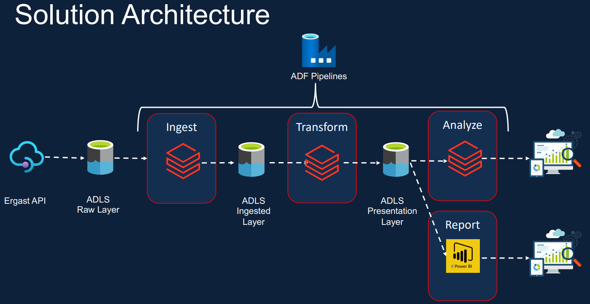

# 🏎️ Formula 1 Azure Databricks Medallion Lakehouse Project

> ### 👋 Visiting from a CV or Application? Start with the Interactive Artifacts:
> | Artifact | Audience | What You'll See | Direct Link |
> | :--- | :--- | :--- | :--- |
> | **🏁 Executive & Recruiter Showcase Deck** | Recruiters, Hiring Managers, Strategy Leads | 3-persona lens switcher (`Recruiter` / `Lead DE` / `Strategy Executive`), interactive Medallion & ADF explorer, and a live Cross-Era FIA Points Equalizer. | **[Launch Showcase Deck ↗](https://siza94.github.io/F1-Data-Project/)** |
> | **📘 8-Phase Engineering Lifecycle Report** | Senior Data Engineers & Technical Interviewers | Full lifecycle record (Phases 01–08): 312.5% FIA scoring inflation analysis, incremental Delta Lake `MERGE INTO` architecture, Medallion ERD, and ADF orchestration. | **[Read Engineering Report ↗](https://siza94.github.io/F1-Data-Project/f1_data_project_report.html)** |

---

This project demonstrates a complete **end-to-end cloud data engineering solution** using **Azure Databricks**, **Delta Lake**, **Azure Data Lake Storage Gen2 (ADLS)**, **Azure Key Vault**, **Azure Data Factory (ADF)**, and **Power BI**, built on 70+ years of real-world Formula 1 World Championship and telemetry data (1950–2021).

---

## 🚀 Key Architectural Highlights

1. **Cross-Era FIA Points Normalization (`Formula1/transformed/4.calculated_race_results.py`)**: Between 1950 and 2010, the FIA inflated P1 race win points by **312.5%** (from 8 pts to 25 pts). Our Gold table computes `11 - position AS calculated_points` for all top-10 finishers and merges incremental cutovers atomically via Delta `MERGE INTO`.
2. **1950s Shared-Car Deduplication & Delta Lake `MERGE INTO` (`Formula1/ingestion/5.ingest_results_file.py`, `Formula1/includes/common_functions.py`)**: Deduplicates 1950s shared-car entries on `(driver_id, race_id)` prior to executing `DeltaTable.forPath().merge()` with Dynamic Partition Pruning (`spark.databricks.optimizer.dynamicPartitionPruning.enabled = true`).
3. **Strict Schema Enforcement & Shared Utilities (`Formula1/ingestion/8.ingest_qualifying_file.py`)**: Enforces explicit `StructType` definitions across all 8 datasets, preserving formatted qualifying lap time strings (`"1:26.572"`) as `StringType()` and centralizing partition utilities inside `common_functions.py`.
4. **Decoupled Upstream Ingestion Architecture**: Separates the Bronze ADLS Gen2 cutover landing zone from the upstream HTTP host for seamless continuity with **Jolpica-F1**, **FastF1** 3.7 Hz telemetry, and **Unity Catalog External Locations**.

---

## 🛠️ Technologies Used

- **Azure Databricks** – PySpark DataFrame API, Spark SQL, Parameterized Notebook Widgets
- **Delta Lake** – ACID `MERGE INTO` upserts, Dynamic Partition Pruning, Schema Enforcement
- **Azure Data Factory (ADF)** – Master/Child Pipeline Orchestration (`Get Metadata`, `If Condition`, `Execute Pipeline`, Tumbling Window Triggers)
- **Azure Data Lake Storage Gen2 (ADLS)** – Medallion Storage (`bronze`, `silver`, `gold` containers)
- **Azure Key Vault & Entra Service Principal** – Secret Scope Authentication (`formula1-scope`)
- **Power BI & Databricks SQL** – Cross-era driver and constructor dominance reporting

---

## 📊 Solution Overview

### 1. **Ingestion (`Formula1/ingestion/`)**
- Ingests 8 heterogeneous datasets from ADLS Gen2 cutover folders (`2021-03-21`, `2021-03-28`, `2021-04-18`):
  - Single-file CSVs (`circuits.csv`, `races.csv`)
  - Single-line & nested `STRUCT` JSONs (`constructors.json`, `drivers.json`, `results.json`)
  - Multi-line JSON (`pit_stops.json`)
  - Multi-file split directories (`lap_times/lap_times_split_*.csv`, `qualifying/qualifying_split_*.json`)
- Enforces explicit `StructType` schemas on read and appends audit metadata (`ingestion_date`, `data_source`, `file_date`).

### 2. **Transformation & Selective Season Reprocessing (`Formula1/transformed/`)**
- Joins normalized Silver tables to produce `f1_gold.race_results`, `f1_gold.driver_standings`, `f1_gold.constructor_standings`, and `f1_gold.calculated_race_results`.
- Uses `df_column_to_list()` to identify only the `race_year` partitions affected by an incoming cutover batch and ranks standings via `Window.partitionBy("race_year").orderBy(desc("total_points"), desc("wins"))`.

### 3. **Pipeline Orchestration (`ADF_parent_pipeline.png`)**
- Modular ADF pipelines (`pl_process_formula1_data` → `pl_ingest_formula1_data` → `pl_transform_formula1_data`) gated by `Get Metadata` (`exists`) and `If Condition` activities.

---

## 📸 Solution Architecture & Master Pipeline

  
   
  <em>Azure Databricks Medallion Lakehouse Architecture</em>

  
   
  <em>Master ADF pipeline orchestrating ingestion and transformation</em>

---

## 📘 Interactive Documentation & Portfolio Artifacts

- 🏁 **[Executive & Recruiter Showcase Deck (`f1_data_showcase_deck.html`)](https://siza94.github.io/F1-Data-Project/)**
- 📘 **[8-Phase Engineering Lifecycle Report (`f1_data_project_report.html`)](https://siza94.github.io/F1-Data-Project/f1_data_project_report.html)**
- 📄 **[Project Walkthrough Presentation (PDF)](./Azure_databricks_data_engineering_project.pdf)**

---

## 👨🏽‍💻 Author

**Sithsaba Zantsi**  
_Data Engineer_  
📫 [Connect on LinkedIn](https://www.linkedin.com/in/sithsaba-zantsi/)

---

## 📜 License

This project is for educational and portfolio demonstration purposes and does not hold any proprietary data or licensing constraints.
